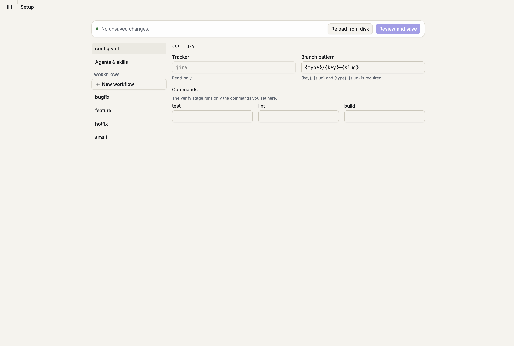
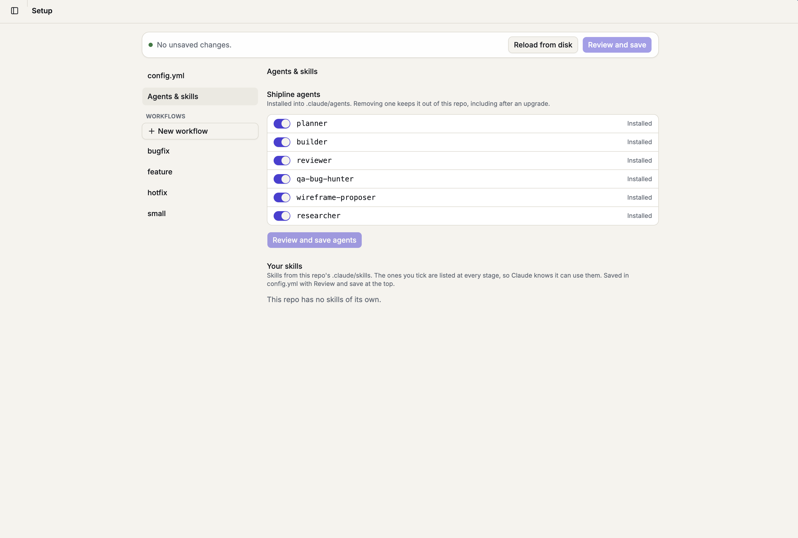

# Shipline

Shipline installs one shared, guardrailed workflow into a git repo so that everyone using Claude Code there
works the same way: pick a workflow, move through stages, save an artifact for each stage, and let hooks
stop the steps that shouldn't happen yet (editing source before the plan is done, committing before verify).

## 1. What Shipline is

- **Workflows.** Feature, Bugfix, Hotfix and Small change. Each is a list of stages (for example Feasibility,
  Open questions, Plan, Implement, Verify, Commit and PR). Claude picks the workflow and starts it.
- **Stages and artifacts.** Each stage has rules (`.shipline/rules/<stage>.md`) and an artifact (such as
  `plan.md`) that must exist before the stage can finish. Progress is recorded with `stage.mjs`.
- **Guardrails.** Hooks in `.claude/settings.json` run on every session. A stage can only guide, warn, or block.
- **A browser UI.** `npx @forgeyard/shipline ui` is a local web app to chat with Claude in the repo, edit the
  setup (workflows, rules, agents and skills) and watch tasks.

Everything Shipline adds to the repo is plain files you commit. Teammates get it on clone, with nothing to
install beyond Node.

## 2. Requirements

| For | You need |
| --- | --- |
| The hooks, `init --yes`, `upgrade`, `uninstall` | Node 18+ |
| Interactive `init` (it asks questions) | Node 20.17+ |
| `shipline ui` | Node 20+ |
| Everything | [Claude Code](https://docs.claude.com/en/docs/claude-code/setup) signed in, and git |

## 3. Install

Run it from the root of the repo you want to set up:

```bash
npx @forgeyard/shipline init          # interactive: choose workflows, agents and skills
npx @forgeyard/shipline init --yes    # install the defaults, no questions
npx @forgeyard/shipline init --dry-run  # preview only
```

In a terminal, `init` asks which workflows, which Shipline agents and which of your repo's own skills to use,
and what to do when one of Shipline's agent names already exists in `.claude/agents/` (keep yours, use ours,
or skip). `--yes` installs everything and keeps your own agent files on a clash. Without a terminal and
without `--yes` it refuses. If any other file name collides, it aborts with nothing written. Running it again
reports "already initialized".

`init` also detects your test, lint and build commands from the repo root (Node with npm, pnpm, yarn or bun;
Python with pytest and ruff or flake8; Go; Rust; Make targets) and asks you to confirm them, and asks which
tracker you use (GitHub Issues or Jira). Every stage ships with default rules; run `/shipline-setup` in Claude
Code (or **Setup → Set up with Claude** in the UI) to tailor them to the repo. Until you do, Shipline reminds
you once per developer.

**What gets added to the repo (commit all of it):**

- `.shipline/`: `config.yml`, `workflows/*.yml`, `rules/<stage>.md`, `bin/*.mjs` (the hook and stage scripts,
  dependency-free) and `bin/VERSION`.
- `.claude/agents/` and `.claude/skills/shipline-setup`, `.claude/skills/shipline-workflow`.
- Hook entries and allow rules merged into `.claude/settings.json`.
- A `<!-- shipline:start -->` block in `CLAUDE.md`.

**What stays out of the repo.** Task data (each task's `manifest.json` and artifacts, session state and UI
data) lives in `~/.shipline/projects/<repo path>/`, the way Claude Code keeps its chats. It is personal, not
shared through git. A new session resumes your unfinished tasks from there.

The old `/shipline:init` Claude Code plugin is gone; `npx @forgeyard/shipline init` replaces it.

## 4. Daily use

Open Claude Code in the repo and describe the work. Claude follows the `shipline-workflow` skill:

1. **Picks a workflow.** For a typo, rename, config tweak or one-file fix it says "Using the Small change
   workflow" and starts. For anything else it asks once ("This looks like a feature, so I'll follow the
   Feature workflow. OK?"). Quick questions don't start a workflow.
2. **Works stage by stage.** Default stages:

   | Workflow | Stages |
   | --- | --- |
   | Feature | Ticket (optional), Feasibility, Open questions, Plan, Wireframes (UI work only), Implement, Verify, Commit and PR |
   | Bugfix | Ticket (optional), Reproduce, Root cause, Fix, Verify, Commit and PR |
   | Hotfix | Ticket (optional), Fix, Verify, Commit and PR |
   | Small change | Ticket (optional), Implement, Verify, Commit and PR |

3. **Asks you at the gates.** Stages with `confirm_to_advance: true` need your OK before Claude moves on.

**Enforcement.** Each stage sets `enforcement`:

- `guide`: advice only; nothing is stopped.
- `warn`: Claude gets a reminder when it does something the stage holds back.
- `block`: the tool call is denied until the stage that holds it back is done. By default, editing source is
  blocked until Plan is done, and `git commit` / `gh pr create` until Verify is done.

A broken config fails open with a visible warning instead of locking you out. Hooks run inside Claude; they
are not a server-side gate.

**`stage.mjs`.** Claude records progress with it; you can run it too from the repo root:

```bash
node .shipline/bin/stage.mjs workflows                 # list workflows
node .shipline/bin/stage.mjs start --workflow feature --title "Add export" [--ticket PROJ-12 | --ticket 123]
node .shipline/bin/stage.mjs status                    # where am I
node .shipline/bin/stage.mjs advance                   # finish the stage (asks you first where the stage needs your OK)
node .shipline/bin/stage.mjs skip --reason "no ticket" # optional stages
node .shipline/bin/stage.mjs pr-summary                # the summary to paste into the PR description
node .shipline/bin/stage.mjs reopen <stage>            # go back
node .shipline/bin/stage.mjs resume <task folder>      # pick up an unfinished task
```

## 5. The browser UI

```bash
npx @forgeyard/shipline ui [dir] [--port <n>] [--no-open]
```

It starts a server on `127.0.0.1` (a random port unless `--port`) for the repo you run it in and opens
`http://127.0.0.1:<port>/?t=<token>`. Ctrl+C stops it. The token is swapped for a cookie on first load, and
requests with a foreign `Host` or `Origin` are refused. The UI is optional: the hooks enforce the workflow
with or without it. It runs your own installed `claude` and never sees your Claude credentials.

- **Chat:** talk to Claude in the repo. Permission and question prompts appear in the page. A chat can always
  be continued in a terminal with `claude --resume <id>`. One chat can work through several tasks: its side
  panel lists every task it touched (the current one with its stages and files), plus a collapsible list of the
  working-tree changes. Unfinished tasks no chat is working on appear on the new-chat screen with **Resume**.
- **Setup:** forms for `config.yml`, each workflow and each rules file. Saving shows a diff first, keeps the
  fields it doesn't know, and lists open tasks that still use an old stage list. Commit the files after saving.

  

  The **Agents & skills** tab chooses which Shipline agents and repo skills are installed.

  


A repo installed by an older Shipline shows a banner with what its hook scripts lack. A repo set up by a newer
Shipline is read-only in the UI and shows the `npx @forgeyard/shipline@<version> ui` command to run.

## 6. Configuration reference

**`.shipline/config.yml`**

```yaml
branch_pattern: "{type}/{key}-{slug}"   # {key} = PROJ-12 (Jira) or issue-123 (GitHub), dropped with no ticket
tracker: jira                           # jira (Atlassian MCP) or github (the gh CLI); read-only either way
commands:                               # filled by init from the repo; the Verify stage runs only these
  test: "pnpm test"
  lint: "pnpm run lint"
  build: "pnpm run build"
skills: []                              # your own .claude/skills/<name> that Claude may use at any stage
setup: done                             # written by /shipline-setup; stops the setup reminder
```

**Workflow files** (`.shipline/workflows/<id>.yml`): `id`, `name`, `description` and a list of `stages`. Stage fields:

| Field | Meaning |
| --- | --- |
| `id`, `name` | The stage's id (also the rules file name) and label |
| `artifact` | File in the task folder that must exist to finish the stage |
| `optional` | The stage may be skipped |
| `condition: ui_only` | Runs only when the task is flagged as UI work |
| `agent` | Suggested subagent |
| `confirm_to_advance` | Ask the developer before moving on |
| `enforcement` | `guide`, `warn` or `block` |
| `blocks` | What is held back until this stage is done: `{ tools: 'Edit\|Write', allow_paths: [globs] }` or `{ bash: 'regex' }` |

**Rules files** (`.shipline/rules/<stage>.md`): plain Markdown that Claude reads before each stage. They ship
with default guidance; `upgrade` replaces a rules file only while it is still an untouched shipped version.

With `tracker: github`, a task started from issue #123 gets the branch `feature/issue-123-…`, the ticket stage
reads the issue with `gh issue view`, and `pr-summary` starts with `Closes #123`.

**`.shipline/bin/VERSION`**: JSON recording the package version, the interface version, a hash of each
Shipline-owned file (so `upgrade` knows what you edited) and `excluded` (agents you kept as your own).

**`SHIPLINE_HOME`**: where task data lives. Default `~/.shipline`. With a custom value Claude asks permission
for artifact writes, because the allow rules cover `~/.shipline/**`.

The config files are YAML read by a small built-in parser (a constrained subset) so hooks have no dependencies.
Line endings are kept: a CRLF file stays CRLF when Shipline saves it.

## 7. Upgrade and uninstall

```bash
npx @forgeyard/shipline upgrade [dir] [--yes] [--dry-run] [--force]
npx @forgeyard/shipline uninstall [dir] [--yes] [--dry-run] [--purge]
```

**upgrade** shows a preview and asks before changing anything. `--dry-run` only previews, `--yes` skips the
question, `--force` also replaces Shipline files your team edited (they are skipped otherwise). It moves tasks
from an old in-repo folder into `~/.shipline` and never commits: review and commit the result.

**uninstall** previews what it will remove, then asks. It removes `.shipline/`, the agents and skills Shipline
installed (agents you kept as your own are left alone), the `CLAUDE.md` block, and Shipline's hook entries and
allow rules in `.claude/settings.json`. It asks separately whether to delete this repo's task data in
`~/.shipline/projects/<repo>/`; with `--yes` that data is kept unless you also pass `--purge`. It deletes
files only and never runs git: commit the removal yourself. It refuses while a Shipline UI chat holds the
repo (stop the UI first).

## 8. Troubleshooting

- **A hook warning appears at session start or on a tool call.** Read it: it names the problem (a config
  that doesn't parse, a missing stage). A malformed config fails open, so work isn't blocked; fix the file
  shown, or run `npx @forgeyard/shipline ui` and use Setup.
- **A tool call was denied.** A `block` stage isn't done yet. Finish that stage or tell the developer; don't
  work around it.
- **"Shipline is already initialized".** `init` found `.shipline/`, the `CLAUDE.md` block or the hooks. To
  change agents and skills use the UI (Setup, Agents & skills); to update use `upgrade`; to start over use
  `uninstall`, then `init`.
- **"Repo newer".** The repo was set up by a newer Shipline than the one you ran. Run the newer version, for
  example `npx @forgeyard/shipline@<version> ui`, or `upgrade` with the latest.
- **A task seems lost.** Tasks are stored per repo path under `~/.shipline/projects/`. If you moved or renamed
  the repo folder, the store key changed and the old folder is still on disk; move it to the new key or work
  from the old path. Also check you are on the same machine and `SHIPLINE_HOME` is unchanged.
- **Windows.**
  - Install [Git for Windows](https://git-scm.com/download/win); Claude Code itself requires it.
  - The hook command is `node "$CLAUDE_PROJECT_DIR/.shipline/bin/<x>.mjs"`, which relies on Claude Code
    running hooks through Git Bash. That is untested here; if hooks show an error, please report it.
  - `shipline ui` opens your browser with `start`, and stops a chat with `taskkill`. Stopping can take a few
    seconds.
  - Task data is in `%USERPROFILE%\.shipline`. A repo at `C:\Users\you\repo` is stored as `C--Users-you-repo`.
  - Existing CRLF files keep CRLF when Shipline saves them; new files use LF.

## 9. Contributing

The repo holds only the CLI product:

```
packages/cli   the npm package: bin, src (init, upgrade, uninstall, UI server), templates (what init installs), tests
packages/ui    the React app behind `shipline ui` (built into packages/cli/ui-dist)
docs/          plans and images
.github/       CI and the publish workflow
```

```bash
pnpm install            # the only native build is esbuild
pnpm build:ui           # builds packages/ui into packages/cli/ui-dist
pnpm test               # all CLI tests (Node 20)
pnpm --filter ./packages/cli test:hooks   # the hook and init tests, which must pass on Node 18
```

After changing anything under `packages/cli/templates/`, run `node packages/cli/scripts/hash-templates.mjs` to
record the new template hashes.

**CI** (`.github/workflows/cli.yml`) runs the hook tests on Node 18 and the full suite plus the UI typecheck and
bundle-size check on Node 20, on Ubuntu, macOS and Windows.

**Releasing.** Bump the version in `packages/cli/package.json`, run the hash script, commit, then push a tag
`v<version>` (for example `v0.7.0`). `.github/workflows/publish.yml` checks that the tag matches the package
version and publishes `@forgeyard/shipline` to npm. It needs the `NPM_TOKEN` secret: a granular npm token with
publish rights on the `@forgeyard` scope.

Older design documents live in `docs/plans/`; those describing the v1 hub are marked historical.
