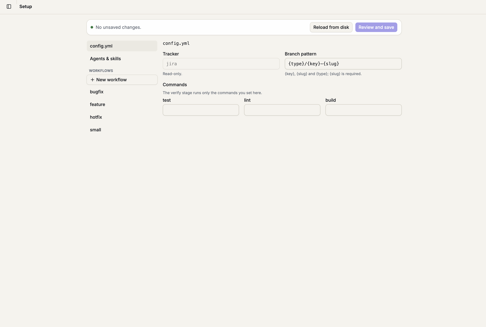

# Shipline

Shipline installs one shared, guardrailed workflow into a git repo so that everyone using Claude Code there
works the same way: pick a workflow, move through stages, save an artifact for each stage, and let hooks
stop the steps that shouldn't happen yet (editing source before the plan is done, committing before verify).

[MIT license](LICENSE) · [Changelog](packages/cli/CHANGELOG.md)

## Quickstart

You need Node 22+, git and [Claude Code](https://docs.claude.com/en/docs/claude-code/setup) signed in.
([Full requirements](docs/install.md#requirements).)

**1. Install it in a repo.** From the repo's root:

```bash
npx @forgeyard/shipline init            # opens the setup wizard in your browser
npx @forgeyard/shipline init --terminal # or answer the same questions in the terminal
npx @forgeyard/shipline init --yes      # or install the defaults without questions
```

It shows what it will write, then ends with a checklist of next steps. Commit what it added so teammates get the
same flow. Want to try it first? [`examples/todo-node`](examples/todo-node) is a tiny project made for this.

**2. Open Claude Code in the repo and ask for a change:**

```bash
claude
> Add a way to delete a todo
```

Claude picks a workflow (Feature, Bugfix, Hotfix or Small change), says which, and works through its stages:

```
[-] ticket (No tracker)
[x] feasibility
[x] questions
[>] plan
[ ] implement
[ ] verify
[ ] pr
```

It stops to ask you at the gates ("Advance?" / "Not yet"), can't edit source until the plan is done, runs your
test, lint and build commands at Verify, and ends the PR description with a summary of the stages and checks.

**3. Tailor it.** Run `/shipline-setup` in Claude Code to fit the default rules to your repo. To add or change a
workflow, describe your process to `/shipline-workflow-designer` (or use **Describe a workflow** in Setup).

## What it stops

Hooks run on every Claude Code session in the repo, with or without a task:

- **Stage blocks:** editing source before Plan is done, `git commit` / `gh pr create` before Verify is done.
- **Guardrails:** force-pushing or pushing to `main`, `curl ... | sh`, printing or reading `.env` and other
  credentials, deploys and migrations, and edits to Claude's own config (some are refused, some ask you first).

Each is configurable (`deny`, `ask` or `off`). Hooks stop mistakes, not a determined user: see
[Guardrails](docs/guardrails.md) for the details and limits.

## The browser UI

```bash
npx @forgeyard/shipline ui
```

A local page (only on `127.0.0.1`) to chat with Claude in the repo, answer its gates and permission prompts, watch
each task's stages and changed files, and edit the setup (workflows, rules, guardrails, agents and skills). In a repo
without Shipline it opens the setup wizard instead. It runs your own `claude` and never sees your credentials.

There is one UI server for every repo on the machine: run `ui` in a second repo and it opens there instead of starting
another. The sidebar lists every chat across your repos, shows when one is waiting for you, **All projects**
gives a combined view and **Health** shows what needs attention. See [Daily use](docs/usage.md#the-browser-ui).



## Use it from your phone

Away from your desk while a chat waits at a gate? Open the same UI on your phone and answer it there. It goes over
your own [Tailscale](https://tailscale.com) network: nothing is public and there is no relay.

1. Install Tailscale on the computer and the phone, signed in to the same account. In the Tailscale admin console,
   turn on **HTTPS certificates** (DNS page).
2. Start the UI with phone access:

   ```bash
   npx @forgeyard/shipline ui --remote
   ```

   (Or switch it on later in **Setup > Phone access**.)
3. In **Setup > Phone access**, press **Pair a phone** and scan the QR code with the phone. Name the device.
4. Optional: in Safari, **Share > Add to Home Screen** to open it like an app. If it shows "not paired", press
   **Enter pairing code** and type the `XXXX-XXXX` code shown under the QR code.

It works while your computer is awake and `shipline ui` is running. The phone stays paired until you **Revoke** it.
Only your own Tailscale user on a paired device can get in, and one paired phone reaches every repo registered on the
computer. Setup, security notes and fixes for "site can't be
reached" are in [Phone access](docs/phone-access.md).

## Commands

| Command | What it does |
| --- | --- |
| `init` | Sets Shipline up in a repo. `--terminal`, `--yes`, `--dry-run`, `--dir <path>` |
| `ui` | Opens the local web UI, one server for every repo (a second run hands over to it). `--remote` (phone access), `--port <n>`, `--no-open`, `--dir <path>` |
| `upgrade` | Updates the installed files to this version. `--yes`, `--dry-run`, `--force`; `--all` for every registered repo |
| `uninstall` | Removes what `init` installed. `--yes`, `--dry-run`, `--purge` |
| `prune` | Removes the task data of repos that no longer exist. `--dry-run`, `--yes` |
| `relink` | Gives a moved repo the task data of its old path. `--from <old path>`, `--dry-run`, `--dir <path>` |

Run `npx @forgeyard/shipline <command> --help` for details, and `npx @forgeyard/shipline@latest upgrade` to update (`@latest` avoids npx's cached older copy). Task data lives in `~/.shipline`, not in your repo.

## FAQ

**What does it add to my repo?** With the defaults (`init --yes`, four workflows): 43 files, about 280 KB.
- `.shipline/` holds `config.yml`, the workflows, one rules file per stage and the hook scripts. The scripts are
  plain Node with no dependencies.
- `.claude/` holds the agents, the skills and the hook entries in `settings.json`.
- `CLAUDE.md` gets one marked block.

They're committed so everyone who clones the repo gets the same rules and hooks, with no install step and no
network call when a hook runs. Your tasks and their documents live in `~/.shipline`, not in the repo.
`npx @forgeyard/shipline uninstall` removes everything `init` added.

**How many tokens does it cost?** A little. These are estimates for the default install, at about 4 characters per token:

| What | When | Tokens |
| --- | --- | --- |
| The `CLAUDE.md` block, plus the skill and agent descriptions | Every request | ~750 |
| The workflow reminder from the prompt hook | Each message you send | ~100–150 |
| The workflow skill | Once per task | ~2,800 |
| One stage's rules | Once per stage | ~150–300 |

Guardrails and stage checks run as hooks, outside the model, so they cost no tokens.

**Does it slow Claude down?** Barely. The tool-call hook is a short Node process: about 55 ms per call on a recent
Mac, small next to a model response.

**Can Claude get around it?** Not by itself:
- The hooks refuse the blocked tool calls.
- Stages only move forward through `stage.mjs`, which checks each stage's document, your commands and your answers.
- Claude can't edit task progress or approve its own gates.

It isn't a sandbox, though. Hooks stop mistakes, not a determined user, and anything done outside Claude Code isn't
checked. For hard limits, add Claude Code's sandbox and managed settings, and use the pull-request check with branch
protection. See [Guardrails](docs/guardrails.md).

**Do I need the browser UI?** No. Everything works in plain `claude` in the terminal; the UI is optional.

**Which platforms?** macOS, Linux and Windows. Every pull request is tested on Linux and Windows in CI, and the
suite is run on macOS locally. The CLI and UI need Node 22+. The hooks
also run on Node 18.

## Documentation

- [Install, upgrade and uninstall](docs/install.md): requirements, every `init` option, what gets written
- [Daily use](docs/usage.md): workflows and stages, enforcement, `stage.mjs`, the browser UI
- [Configuration reference](docs/configuration.md): `config.yml`, workflow files, checks, confirmations
- [Guardrails and the pull-request check](docs/guardrails.md): every rail, protected paths, the CI check
- [Use it from your phone](docs/phone-access.md)
- [Troubleshooting](docs/troubleshooting.md)
- [Contributing](CONTRIBUTING.md)

## License

[MIT](LICENSE). See the [changelog](packages/cli/CHANGELOG.md) for what changed in each release.
