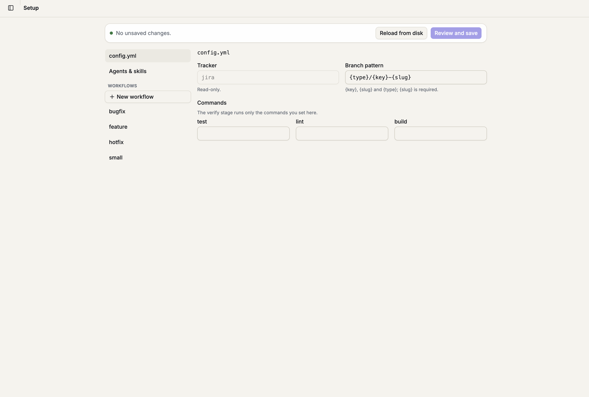
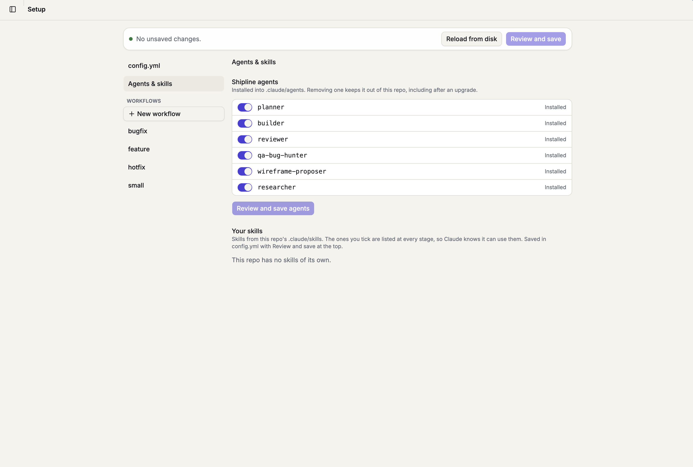

# Daily use

How a session runs, how stages are enforced, `stage.mjs`, and the browser UI.

[Back to the README](../README.md)

## How a session runs

Open Claude Code in the repo and describe the work. Claude follows the `shipline-workflow` skill:

1. **Picks a workflow.** For a typo, rename, config tweak or one-file fix it says "Using the Small change
   workflow" and starts. For anything else it asks once ("This looks like a feature, so I'll follow the
   Feature workflow. OK?"). Quick questions don't start a workflow.
2. **Works stage by stage.** Default stages:

   | Workflow | Stages |
   | --- | --- |
   | Feature | Ticket (optional), Feasibility, Open questions, Plan, Wireframes (UI work only), Implement, Verify, Commit and PR |
   | Bugfix | Ticket (optional), Reproduce, Root cause, Fix, Verify, Commit and PR |
   | Hotfix | Ticket (optional), Fix, Verify, Commit and PR |
   | Small change | Ticket (optional), Implement, Verify, Commit and PR |

   Five more workflows ship but are not installed by default; add them in **Setup → Add shipped workflow** (or tick
   them in the install wizard or `init`):

   | Workflow | Stages |
   | --- | --- |
   | Spike / Research (`spike`) | Question, Research (no PR or merge until it is done) |
   | Refactor (`refactor`) | Ticket (optional), Plan, Implement, Verify, Commit and PR |
   | Docs (`docs`) | Ticket (optional), Outline, Write (source edits blocked, docs edits allowed), Review, Commit and PR |
   | Dependency bump (`deps`) | Ticket (optional), Assess, Upgrade, Verify, Commit and PR |
   | Release (`release`) | Prepare, Verify (no release or deploy until it is done), Publish |

3. **Asks you at the gates.** Stages with `confirm_to_advance: true` need your OK before Claude moves on.

**Enforcement.** Each stage sets `enforcement`:

- `guide`: advice only; nothing is stopped.
- `warn`: Claude gets a reminder when it does something the stage holds back.
- `block`: the tool call is denied until the stage that holds it back is done. By default, editing source is
  blocked until Plan is done, and `git commit` / `gh pr create` until Verify is done.

A config.yml that can't be read doesn't lock you out or turn the guardrails off: the rails use their built-in
defaults and every call carries a warning that says so. Other unexpected hook errors fail open with a visible
warning. Hooks run inside Claude; they are not a server-side gate.

**`stage.mjs`.** Claude records progress with it; you can run it too from the repo root:

```bash
node .shipline/bin/stage.mjs workflows                 # list workflows
node .shipline/bin/stage.mjs start --workflow feature --title "Add export" [--ticket PROJ-12 | --ticket 123]
node .shipline/bin/stage.mjs status                    # where am I (--verbose adds the rules text and full paths)
node .shipline/bin/stage.mjs advance                   # finish the stage (asks you first where the stage needs your OK)
node .shipline/bin/stage.mjs skip --reason "no ticket" # optional stages
node .shipline/bin/stage.mjs check                      # run the test, lint and build commands and record the results
node .shipline/bin/stage.mjs pr-summary                # the summary to paste into the PR description
node .shipline/bin/stage.mjs reopen <stage>            # go back
node .shipline/bin/stage.mjs resume <task folder>      # pick up an unfinished task
```

Outside a Claude Code session (no session id), `status` lists the unfinished tasks on the current branch.

## The browser UI

```bash
npx @forgeyard/shipline ui [--dir <path>] [--port <n>] [--no-open] [--remote]
```

It starts a server on `127.0.0.1` (a random port unless `--port`) and opens
`http://127.0.0.1:<port>/?t=<token>#/new/<repo id>` (the new-chat screen, preset to the repo you run it in; the setup wizard for a folder without Shipline). Ctrl+C stops it. The token is
swapped for a cookie on first load, and requests with a foreign `Host` or `Origin` are refused. The UI is optional: the
hooks enforce the workflow with or without it. It runs your own installed `claude` and never sees your Claude
credentials.

**One server for every repo.** There is one UI server per machine. Run `shipline ui` in a second repo (or a
worktree) and it opens that repo in the server that is already running, prints the link, and exits: no second
terminal, port or browser tab per repo.

- The running server is found through `~/.shipline/server.json` (or `$SHIPLINE_HOME`). It lives as long as the terminal
  that started it; stopping it stops every chat it runs.
- `--port <n>` and a different Shipline version don't start a second server: you get a note ("already running on port
  X; stop it to change the port", "<v> is already running; stop it to use <v>") and the folder is handed over anyway.
- `--remote` on a later run turns on phone access in the running server.
- A folder without Shipline opens the setup wizard in the running server, listed as "Not set up" until you press
  Install.
- Repos are listed in `~/.shipline/projects.json`. `init`, `ui` and `upgrade` add a repo, `uninstall` removes it, and
  the first run fills the list from the repos that already have task data. A repo whose folder is gone is greyed out
  as "Folder not found" and can be removed from the list.
- **Chat-first navigation.** The sidebar (the tab bar on a phone) has the same items in every view: **New chat**,
  **All projects** (with the number of chats waiting for you across projects), **Setup** and **Health** (a dot for the
  worst health state), then one flat list of every chat in every project, newest first. Each row shows the title, the
  project (plus the worktree folder when it isn't the main worktree), the workflow, stage dots and a dot when the chat
  waits for you. There is no project switcher: projects are reached through All projects, the project dropdown on New
  chat and the one on Setup, and the chat header names the chat's project (click it to open that project's Setup).
  **Remove from list** (on a project card) only forgets the project; the folder and its task data stay.
- **All projects** (`#/all`): *Needs you* (chats waiting on a permission prompt, a question or confirmation, or that
  stopped with an error you haven't opened), one card per project (worktrees grouped under their repo, with branch,
  state, waiting count, unfinished tasks and a health dot, and **New chat here**, **Setup** and **Remove from list**),
  the unfinished tasks per project, and a one-line health summary. It never opens a repo, so it stays fast with many.
- **Health** (`#/health`) replaces the old Status row and Diagnostics sheet. *This machine*: the server and CLI
  versions, Claude (path, signed in, version), Node, port, phone access and the last 50 lines of the server log. *Projects*:
  one row each with its state, whether setup is done, a `config.yml` error, who holds the chat lock and the warning
  count; expand a row for that project's diagnostics (redacted, safe to paste into a bug report). The dot is red when
  Claude is missing or signed out, the project needs a reinstall or a newer Shipline, or `config.yml` can't be read;
  amber when the folder is missing, setup isn't done or there are warnings; green otherwise.
- A repo set up with a newer Shipline (or before 1.0) shows a card instead of its pages, and only that repo is
  affected: the others keep working. For a newer one, stop the server and run
  `npx @forgeyard/shipline@<version> ui`.
- Chats can run in two repos at once; each repo still runs one chat at a time.

To update every repo at once: `npx @forgeyard/shipline upgrade --all` (see [Upgrade and uninstall](install.md#upgrade-and-uninstall)).

- **Chat:** talk to Claude in the repo. While Claude works, a row at the end of the messages shows what it is
  doing and for how long. On desktop, **Esc** stops the current turn and the chat stays active; **Stop** in the
  header ends the whole chat. Permission and question prompts dock above the message box, on desktop and phone,
  and an answered question stays in the history as one line. A chat can always be continued in a terminal with
  `claude --resume <id>`. One chat can work through several tasks: its side panel lists every task it touched
  (the current one with its stages and files), plus a collapsible list of the working-tree changes. Unfinished
  tasks no chat is working on appear on the new-chat screen with **Resume**.
- **Setup:** forms for `config.yml`, each workflow and each rules file. Saving shows a diff first, keeps the
  fields it doesn't know, and lists open tasks that still use an old stage list. Commit the files after saving.

  

  **Describe a workflow** (next to New workflow and Add shipped workflow) opens a chat that runs
  `/shipline-workflow-designer`. You describe your process in plain words; Claude proposes the stages, gates and rules,
  checks them, and leaves a draft. A **Draft ready** banner on Setup (and a notice in the chat) has **Review**, which
  opens the same diff dialog as a Setup save, and **Discard**. Nothing is written to the repo until you save. **Change
  with Claude**, on a workflow's page, does the same for an existing workflow. If the workflow was edited after the
  draft was made, Save asks you to **Overwrite** or Cancel. Repos installed before this version show "Upgrade this repo
  to use Describe a workflow" until you run `upgrade`. In a terminal, run `/shipline-workflow-designer` in Claude Code
  and it writes the files after you approve a summary.

  The **Agents & skills** tab chooses which Shipline agents and repo skills are installed.

  

A repo set up by a newer Shipline shows a card with the `npx @forgeyard/shipline@<version> ui` command to run (stop this server first).
