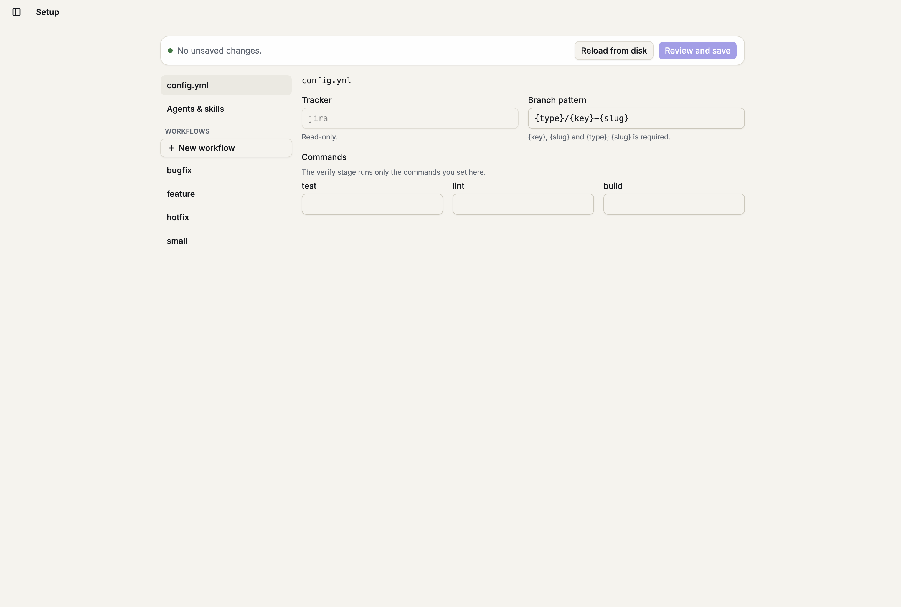
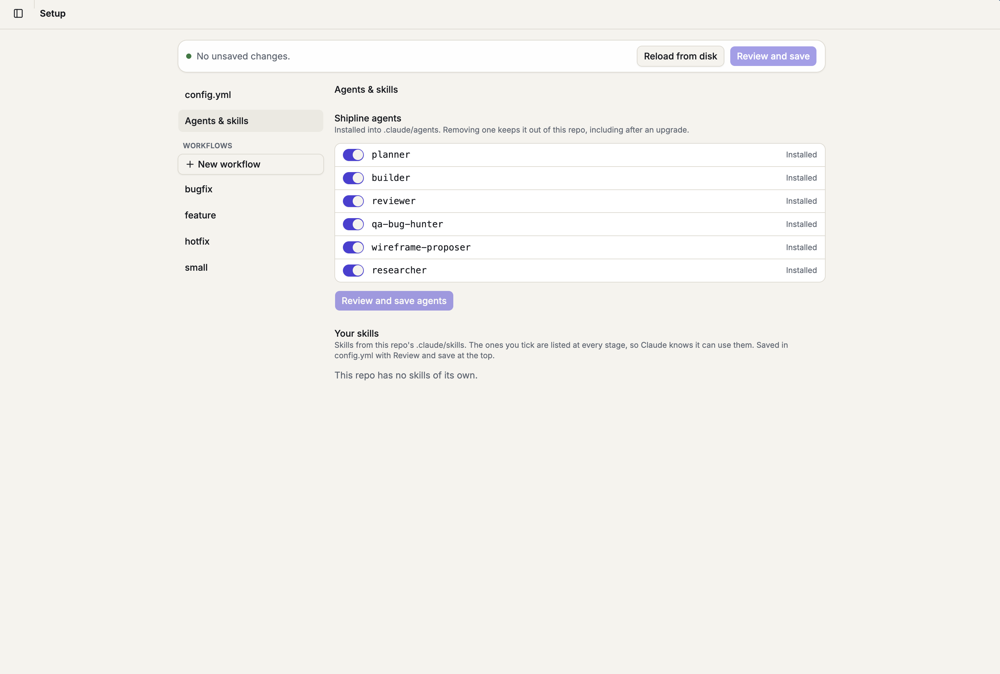

# Daily use

How a session runs, how stages are enforced, `stage.mjs`, and the browser UI.

[Back to the README](../README.md)

## How a session runs

Open Claude Code in the repo and describe the work. Claude follows the `shipline-workflow` skill:

1. **Picks a workflow.** For a typo, rename, config tweak or one-file fix it says "Using the Small change
   workflow" and starts. For anything else it asks once ("This looks like a feature, so I'll follow the
   Feature workflow. OK?"). Quick questions don't start a workflow.
2. **Works stage by stage.** Default stages:

   | Workflow | Stages |
   | --- | --- |
   | Feature | Ticket (optional), Feasibility, Open questions, Plan, Wireframes (UI work only), Implement, Verify, Commit and PR |
   | Bugfix | Ticket (optional), Reproduce, Root cause, Fix, Verify, Commit and PR |
   | Hotfix | Ticket (optional), Fix, Verify, Commit and PR |
   | Small change | Ticket (optional), Implement, Verify, Commit and PR |

3. **Asks you at the gates.** Stages with `confirm_to_advance: true` need your OK before Claude moves on.

**Enforcement.** Each stage sets `enforcement`:

- `guide`: advice only; nothing is stopped.
- `warn`: Claude gets a reminder when it does something the stage holds back.
- `block`: the tool call is denied until the stage that holds it back is done. By default, editing source is
  blocked until Plan is done, and `git commit` / `gh pr create` until Verify is done.

A config.yml that can't be read doesn't lock you out or turn the guardrails off: the rails use their built-in
defaults and every call carries a warning that says so. Other unexpected hook errors fail open with a visible
warning. Hooks run inside Claude; they are not a server-side gate.

**`stage.mjs`.** Claude records progress with it; you can run it too from the repo root:

```bash
node .shipline/bin/stage.mjs workflows                 # list workflows
node .shipline/bin/stage.mjs start --workflow feature --title "Add export" [--ticket PROJ-12 | --ticket 123]
node .shipline/bin/stage.mjs status                    # where am I (--verbose adds the rules text and full paths)
node .shipline/bin/stage.mjs advance                   # finish the stage (asks you first where the stage needs your OK)
node .shipline/bin/stage.mjs skip --reason "no ticket" # optional stages
node .shipline/bin/stage.mjs check                      # run the test, lint and build commands and record the results
node .shipline/bin/stage.mjs pr-summary                # the summary to paste into the PR description
node .shipline/bin/stage.mjs reopen <stage>            # go back
node .shipline/bin/stage.mjs resume <task folder>      # pick up an unfinished task
```

Outside a Claude Code session (no session id), `status` lists the unfinished tasks on the current branch.

## The browser UI

```bash
npx @forgeyard/shipline ui [--dir <path>] [--port <n>] [--no-open] [--remote]
```

It starts a server on `127.0.0.1` (a random port unless `--port`) for the repo you run it in and opens
`http://127.0.0.1:<port>/?t=<token>`. Ctrl+C stops it. The token is swapped for a cookie on first load, and
requests with a foreign `Host` or `Origin` are refused. The UI is optional: the hooks enforce the workflow
with or without it. It runs your own installed `claude` and never sees your Claude credentials.

- **Chat:** talk to Claude in the repo. While Claude works, a row at the end of the messages shows what it is
  doing and for how long. On desktop, **Esc** stops the current turn and the chat stays active; **Stop** in the
  header ends the whole chat. Permission and question prompts dock above the message box, on desktop and phone,
  and an answered question stays in the history as one line. A chat can always be continued in a terminal with
  `claude --resume <id>`. One chat can work through several tasks: its side panel lists every task it touched
  (the current one with its stages and files), plus a collapsible list of the working-tree changes. Unfinished
  tasks no chat is working on appear on the new-chat screen with **Resume**.
- **Setup:** forms for `config.yml`, each workflow and each rules file. Saving shows a diff first, keeps the
  fields it doesn't know, and lists open tasks that still use an old stage list. Commit the files after saving.

  

  The **Agents & skills** tab chooses which Shipline agents and repo skills are installed.

  

A repo set up by a newer Shipline is read-only in the UI and shows the `npx @forgeyard/shipline@<version> ui` command to run.
